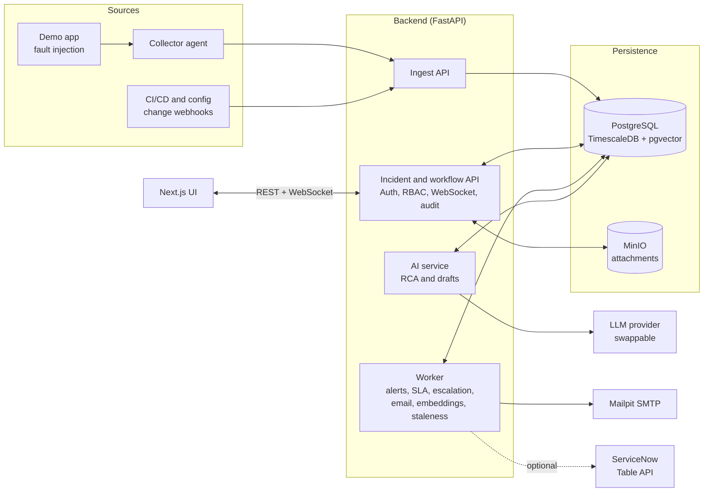
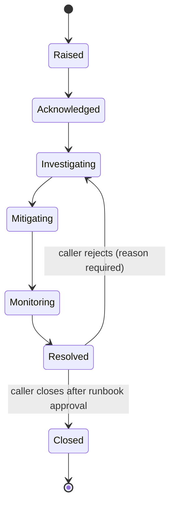

# InfraWatch 2.0

Unified observability, incident management and AI-assisted root cause analysis in a single application.

> **Project status: Phase 1, milestone M0 (repository foundation).** The repository contains the workspace layout, service skeletons, container builds, continuous integration and the architecture decision records. None of the product capabilities described below is implemented yet; sections that describe commands, ports or behaviour are marked as planned. The authoritative requirements are in [`docs/specification.html`](./docs/specification.html), the delivery plan is in [`docs/phase-1-plan.md`](./docs/phase-1-plan.md), and design decisions are recorded in [`docs/adr/`](./docs/adr/).

---

## Table of contents

1. [Overview](#overview)
2. [Planned capabilities](#planned-capabilities)
3. [Architecture](#architecture)
4. [Technology stack](#technology-stack)
5. [Incident lifecycle](#incident-lifecycle)
6. [Roles](#roles)
7. [Runbooks and the knowledge base](#runbooks-and-the-knowledge-base)
8. [AI layer](#ai-layer)
9. [Repository layout](#repository-layout)
10. [Planned getting-started workflow](#planned-getting-started-workflow)
11. [Roadmap](#roadmap)
12. [Acceptance criteria](#acceptance-criteria)
13. [Testing and continuous integration](#testing-and-continuous-integration)
14. [Open items](#open-items)
15. [Contributing](#contributing)
16. [License](#license)

---

## Overview

Observability tooling and IT service management tooling are usually separate products. An engineer who notices a problem in a dashboard must open a ticket by hand, copy context into it, find the right team and, afterwards, reconstruct what happened. Context is lost, response is slower, and the knowledge gained in each incident rarely reaches the next engineer who faces something similar.

InfraWatch 2.0 joins these concerns in one workflow with four stages:

| Stage | Description |
|---|---|
| **Observe** | A shared, read-only view of system health: infrastructure metrics, application metrics, logs and change events. |
| **Raise** | Production Support reviews an alert-generated draft, or raises an incident directly, with observability data and other evidence attached. |
| **Collaborate** | The incident appears in the app and is emailed to the owning team's group address with the on-call engineer in CC. Teams work in parallel against a seven-state progress bar. |
| **Learn** | An incident cannot be closed until a runbook has been written, reviewed and approved. Approved runbooks form a knowledge base used to predict probable root causes for future incidents. |

The platform is built from scratch, with its own collector agent, storage and user interface. It is not layered on Prometheus, Grafana or Loki. ServiceNow integration is optional: the product has its own ticketing and can synchronise with a ServiceNow instance through the Table API.

The primary objective of the first release is a reproducible, end-to-end demonstration at small scale, with an architecture that keeps a path to a production product open.

## Planned capabilities

**Observability**
- Own collector agent reporting CPU, memory, disk and network metrics
- Demo application emitting latency, error-rate and request-rate metrics and structured logs with correlation IDs
- Change-event webhook for deployments, configuration changes and feature-flag changes
- Prebuilt per-service dashboards and a simple panel builder
- A fault-injection command that produces realistic incidents on demand

**Alerting**
- Static threshold rules, statistical anomaly detection and AI-suggested thresholds (human-approved)
- An alert creates a *draft* incident; nobody is notified until Production Support raises it
- Deduplication of repeated firings

**Incident management**
- Seven-state lifecycle, severity P1 to P4 and SLA timers with breach flags
- Parallel team tasks under one incident, with assignment inside each team
- Attachments: frozen metric snapshots, log excerpts, files and screenshots, links and notes
- Group email per team with the on-call engineer in CC; on-call rotation with automatic escalation
- Closure only by the caller, after runbook approval; the caller may reject a resolution and reopen
- Immutable audit log of every change

**Knowledge and AI**
- Structured runbooks with a controlled root cause taxonomy
- Similar-incident retrieval, ranked root cause analysis with cited evidence, runbook drafts and stakeholder communication drafts
- Shadow-mode evaluation, user feedback, an offline benchmark and a staleness health-check

**Integration (optional)**
- Two-way ServiceNow synchronisation with idempotency keys

## Architecture



**Design principles**

- **Server-side enforcement.** State transitions, permissions, mandatory fields and closure rules are enforced in the API, never only in the interface.
- **Degrade gracefully.** Failure of the LLM, ServiceNow or the mail provider must not block the core incident workflow.
- **Configuration over code.** LLM provider, SMTP target, SLA values, retention and taxonomy are configuration.
- **Reproducibility.** One command starts the system from a clean clone; every quoted metric is regenerated by a script in the repository.

## Technology stack

| Concern | Choice |
|---|---|
| Backend | Python, FastAPI |
| Frontend | Next.js |
| Database | PostgreSQL with TimescaleDB (time series) and pgvector (embeddings) |
| Object storage | MinIO (S3-compatible) |
| Email (development) | Mailpit |
| Real-time transport | WebSockets |
| Authentication | Local accounts, JWT, role-based access control |
| AI | Provider-agnostic LLM interface; retrieval through pgvector |
| Deployment | Docker Compose first; cloud deployment later |
| Testing | pytest, Vitest, Playwright |
| CI | GitHub Actions |

## Incident lifecycle



Regression to an earlier active state is permitted with a recorded reason. The API rejects every transition that is not defined. Only the caller (the user who raised the incident) can close it.

**Severity and SLA defaults**

| Severity | Acknowledge within | Resolve within | Escalate if unacknowledged |
|---|---|---|---|
| P1 | 5 minutes | 4 hours | 10 minutes |
| P2 | 15 minutes | 8 hours | 10 minutes |
| P3 | 1 hour | 3 days | Configurable |
| P4 | 4 hours | 7 days | Configurable |

## Roles

Production Support, Developer, SRE, Admin, Incident Commander, Comms, Read-only viewer and Business stakeholder. *Team lead* is a membership attribute that grants assignment rights within a team and runbook approval rights. The full permission matrix is in the specification. Business stakeholders and read-only viewers see incident status and impact only, without logs or attachments.

## Runbooks and the knowledge base

The runbook is the gate between **Resolved** and **Closed**, and the primary source of retrieval and evaluation data. It is therefore structured.

| Field | Required |
|---|---|
| Timeline | Yes |
| Root cause and category (controlled taxonomy) | Yes |
| Contributing factors | Yes |
| Remediation and prevention | Yes |
| Workaround applied | Yes |
| Similar incidents | Yes |

The resolver writes the runbook, a team lead or Incident Commander approves it or returns it with comments, and only then can the caller close the incident. Submission with any required field empty is rejected by the server.

Default root cause categories: Code or deploy; Configuration; Capacity or infrastructure; Dependency or third party; Data; Security; Process or human.

## AI layer

The AI layer has two tiers.

1. **Retrieval.** Runbooks and incidents are embedded and stored in pgvector. A new incident retrieves its most similar predecessors.
2. **Reasoning.** A provider-agnostic LLM interface receives the current evidence and the retrieved runbooks and returns a ranked list of probable root causes, each with a confidence value and the specific supporting evidence.

Principles:

- **Human in the loop.** Every AI output is labelled as AI-generated, is editable, and is never sent, saved as final or applied without an explicit human action.
- **Measured before trusted.** Predictions run in shadow mode and are scored against the approved runbook's root cause. User-facing suggestions are enabled only after accuracy meets a target fixed in advance.
- **Resilient.** If the model is unavailable, the incident workflow continues and the interface says that suggestions are unavailable.
- **Cold start.** With no history, data comes from a synthetic corpus, live fault injection on the demo application, and an import command for sanitised past incidents.

## Repository layout

The top-level structure below exists as of milestone M0; the applications inside it are skeletons. Directories marked *(planned)* are created when their first content is delivered. The layout is described in [ADR 0002](./docs/adr/0002-repository-layout-and-python-workspace.md).

```text
infrawatch/
├── apps/
│   ├── api/            FastAPI service
│   ├── web/            Next.js application
│   ├── worker/         Alerts, SLA, escalation, email, embeddings, jobs
│   ├── agent/          Collector agent
│   └── demo-app/       Sample application with fault injection
├── packages/
│   └── core/           Pure domain logic: state machine, permissions, SLA, escalation
├── deploy/             Container image definitions; Compose files from M1
├── docs/
│   ├── specification.html
│   ├── architecture/   Architecture documentation (planned)
│   └── adr/            Architecture decision records
├── scripts/            Seed, fault injection, import, evaluation (planned)
├── tests/
│   └── e2e/            Playwright end-to-end tests (planned)
├── .github/workflows/  CI pipelines
├── docker-compose.yml  (planned, M1)
├── pyproject.toml      uv workspace and shared Python tool configuration
├── uv.lock
├── .env.example
├── CONTRIBUTING.md
└── README.md
```

## Planned getting-started workflow

> **Not yet available.** The following describes the intended experience. Commands and ports are illustrative and will be confirmed during implementation.

```bash
git clone <repository-url> infrawatch
cd infrawatch
cp .env.example .env
docker compose up
```

Intended local endpoints:

| Service | Planned address |
|---|---|
| Web application | `http://localhost:3000` |
| API and interactive documentation | `http://localhost:8000/docs` |
| Mailpit inbox | `http://localhost:8025` |
| MinIO console | `http://localhost:9001` |

A seed command will load demo users for every role, two teams with group email addresses and the demo service catalogue. A fault-injection command will then trigger an incident that can be followed through the whole lifecycle.

## Roadmap

| Phase | Theme | Delivers |
|---|---|---|
| **P1** | Incident loop | Environment, telemetry, dashboards, static and anomaly alerts, draft-to-raise flow, lifecycle, attachments, email, on-call and escalation, runbooks with approval and closure rules, RBAC and audit, tests and CI |
| **P2** | AI layer | Embeddings and similar incidents, ranked RCA with evidence, AI-suggested thresholds, runbook and comms drafts, shadow mode, feedback, offline benchmark, staleness job, import path |
| **P3** | Hardening and reach | ServiceNow synchronisation, full Grafana-style dashboard builder, cloud deployment, tracing ingestion (candidate) |

There is no fixed deadline. A thin vertical slice through all four stages is preferred over polishing any single stage in isolation.

## Acceptance criteria

The project is accepted against 62 pass/fail checks, grouped into eleven gates. The full wording is in the specification, where the checks can be ticked off interactively.

| Gate | Area | Checks |
|---|---|---|
| G0 | Environment | 3 |
| G1 | Telemetry | 6 |
| G2 | Dashboards and alerting | 6 |
| G3 | Incident lifecycle | 9 |
| G4 | Attachments, notifications and on-call | 7 |
| G5 | Runbooks | 6 |
| G6 | AI and root cause analysis | 10 |
| G7 | ServiceNow synchronisation | 3 |
| G8 | Security and audit | 5 |
| G9 | Quality and CI | 4 |
| G10 | The demonstration | 3 |

Representative checks:

- Only the original caller can move an incident to Closed; any other user receives a 403.
- Closure is blocked until a lead has approved a complete runbook.
- Invalid status transitions are rejected by the API, not merely hidden in the interface.
- A fired alert creates a draft and notifies no one until Production Support raises it.
- The LLM provider can be swapped by configuration alone, and the core workflow survives LLM failure.
- Top-3 root cause accuracy on a held-out set meets a target set before the run, and the result is published.
- Every metric quoted in portfolio material is regenerated by a script in the repository.

## Testing and continuous integration

- **Unit tests:** pytest (backend) and Vitest (frontend), with an agreed coverage floor on the state machine, permissions, SLA and escalation logic.
- **API integration tests:** run against real PostgreSQL/TimescaleDB and MinIO containers.
- **End-to-end tests:** Playwright runs the full loop from fault injection to caller closure.
- **Continuous integration:** GitHub Actions runs lint, type checks, tests and a Docker build on every push; a failing check blocks merging to the main branch.

## Open items

- ServiceNow field mapping for the Table API (deferred to Phase 3)

The remaining former open items were resolved on 2026-11-09; see the [Phase 1 implementation plan](./docs/phase-1-plan.md). In summary: top-3 root cause accuracy target of at least 70% (G6.3), a 90% line and branch coverage floor on core logic (G9.1), a Python collector agent with a bounded on-disk buffer, and a defined WebSocket replay and back-pressure policy.

## Contributing

Development setup, the checks enforced by CI, working practices and the branch protection settings are described in [CONTRIBUTING.md](./CONTRIBUTING.md). Proposed changes to the requirements should be raised against the specification.

## License

To be determined.
