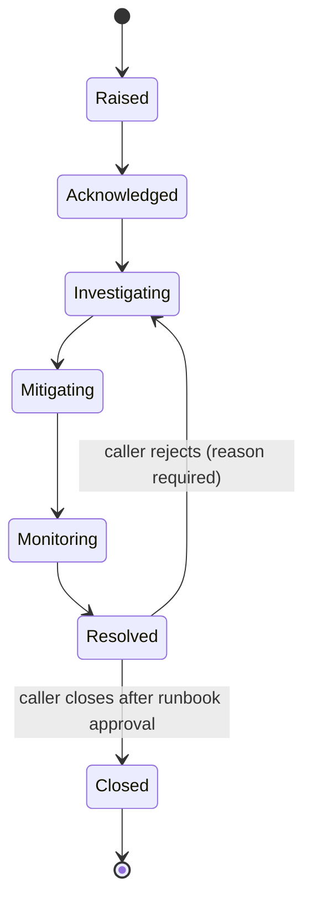
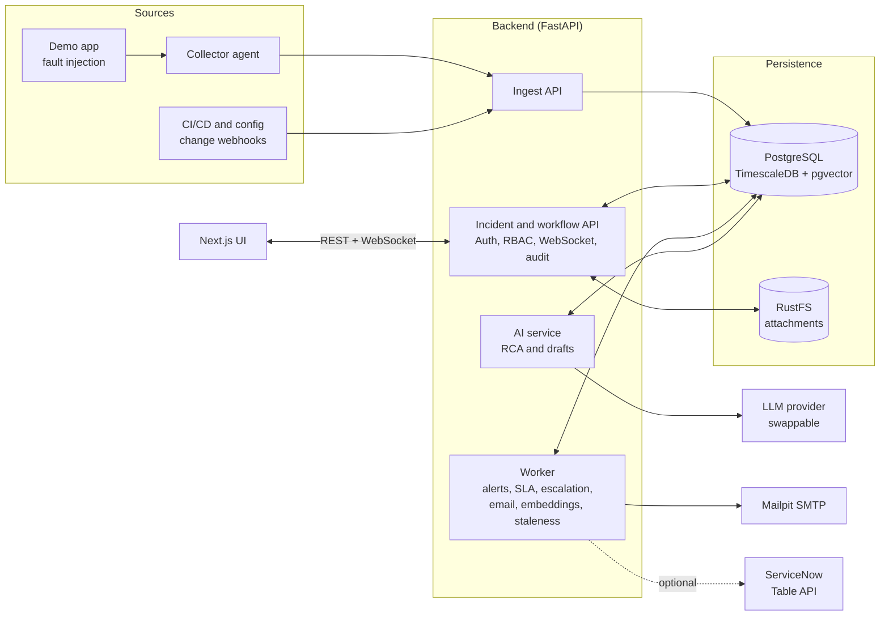

# InfraWatch 2.0: project context for Claude Code

> **Purpose of this file.** It captures everything decided in a long requirements conversation so that a fresh Claude Code session can continue without re-asking questions. Treat sections 3 to 12 as agreed requirements. Section 13 lists what is still open. Section 14 says what to do first.
>
> **How to use it.** Place this file at the repository root (or in `docs/`) and start the session with: *"Read `claude-context.md` fully before doing anything. Then follow section 14."*

---

## 1. Status

- **Stage:** Phase 1 plan approved on 2026-11-09; implementation in progress. **Milestone M0 (repository foundation and CI)** has been implemented: uv workspace, `packages/core`, service skeletons, Dockerfiles, CI workflow, ADRs 0001 to 0016, `CONTRIBUTING.md`. No product capability exists yet; every capability in sections 3 to 12 is still a requirement.
- **Documents in the repository:**
  - `docs/specification.html`: self-contained specification with an architecture diagram (inline SVG) and the 62 acceptance checks as an interactive, tickable list (progress saved in browser storage). Formerly `Great-Observations_Specification.html` at the root.
  - `README.md`: repository README, kept consistent with the specification and the current state.
  - `docs/phase-1-plan.md`: the approved Phase 1 plan (milestones M0 to M10 and the checks each verifies).
  - `docs/adr/`: architecture decision records.
- The repository layout adds `packages/core` (pure domain logic) to the layout in section 15.1; see ADR 0002.

## 2. What the project is

**Working title:** InfraWatch 2.0.

**One-line description:** one application that unifies observability (Grafana/Dynatrace-style health monitoring), incident ticketing (ServiceNow-style), enforced post-incident runbooks, and an AI layer that predicts probable root causes from telemetry and past runbooks.

**Origin of the idea.** In the developer's organisation, observability tools and incident ticketing (ServiceNow) were separate. The idea is to merge them into one app, then add AI-based analysis trained on runbooks.

**Primary objective:** a reproducible, end-to-end **portfolio/resume project**, with the architecture kept open for a real product later. Small scale, personal/learning project, built **from scratch** (explicitly *not* layered on Prometheus, Grafana or Loki). SDLC approach, starting from requirement analysis and phased breakdown. No fixed deadline.

**Developer profile (relevant to how you work with them):** web development, backend/APIs, DevOps/cloud; participates in open-source hackathons. **Prefers a professional, formal tone in developer-facing materials** (README, docs, comments, commit messages).

### 2.1 The four-stage flow (original description, restated)

1. **Observe.** Common read-only observability view for all users (CPU etc. plus application signals).
2. **Raise.** When a user spots a production issue they report it to Production Support. Production Support raises the incident for the developers and stakeholders, attaching observability data and anything else they want to share.
3. **Collaborate.** The incident is visible in the app and an email is sent to the team's **group mail**. Developers put their **on-call** in the app so the on-call engineer is included in **CC**. A **status bar** shows progress and must be updated by all teams. Each group can assign the issue to anyone in their own team.
4. **Learn.** After each incident a **runbook** must be completed with strict analysis; **only then can the caller close the incident**. Runbooks are the knowledge base used to train/ground models that predict root cause from observability data and tickets. Production Support and SRE must keep the system in step with production so the AI can give useful suggestions.

### 2.2 Market positioning (be honest about this in any write-up)

- Several commercial observability vendors already offer ServiceNow integrations; PagerDuty, BigPanda, Moogsoft and ServiceNow's own AIOps occupy the AIOps/event-correlation space. **Do not claim a new category.**
- The project's differentiators: (a) **closure gate**: no close without an approved runbook; (b) a **controlled root-cause taxonomy** that makes runbooks clean training labels; (c) **shadow-mode evaluation** so AI accuracy is measured before it is trusted; (d) a single integrated, self-hostable, demonstrable workflow.

## 3. Decision register (all agreed)

| Area | Decision |
|---|---|
| Purpose | Resume/portfolio first; product path kept open |
| Backend | Python + FastAPI |
| Frontend | Next.js |
| Data stores | PostgreSQL with **TimescaleDB** (time series) and **pgvector** (embeddings); **RustFS** (S3-compatible) for attachments |
| Real-time | **WebSockets** (the assistant had recommended SSE; the user chose WebSockets, so handle reconnect/resume and back-pressure) |
| Auth | Local accounts, JWT, RBAC |
| Deployment | **Docker Compose first**, cloud later |
| Telemetry source | Own collector agent + demo app with fault injection |
| Signals | Infra metrics, app metrics, logs, change events (distributed traces deferred) |
| Alerting | Static thresholds + statistical anomaly detection + AI-suggested thresholds (human-approved) |
| Alert → incident | Alert creates a **draft**; Production Support reviews and raises it |
| Status lifecycle | 7 states: Raised, Acknowledged, Investigating, Mitigating, Monitoring, Resolved, Closed |
| Severity | P1 to P4 with SLA timers |
| Multi-team work | **Parallel team tasks** under one incident and one shared status |
| Closure | Only the **caller** can close; caller can **reject** a resolution and **reopen** |
| Email | **Mailpit** local sink in Compose; group email per team, on-call in CC; sent on raise + major changes |
| On-call | Rotation set in the app + **auto-escalation** of unacknowledged incidents |
| Runbook process | Resolver writes → lead reviews/approves → caller closes |
| Runbook fields | Timeline; root cause + category; contributing factors; remediation + prevention; **workaround applied**; **similar incidents** |
| Root-cause labels | Controlled category list + free-text detail |
| AI model access | Provider-agnostic LLM interface; retrieval via pgvector |
| AI features | Ranked RCA with evidence; similar incidents; runbook draft; stakeholder comms draft |
| AI data supply | Synthetic corpus **and** live fault injection **and** import path for sanitised real incidents (all three kept) |
| AI evaluation | Shadow mode + accuracy scoreboard; thumbs up/down; offline held-out benchmark; staleness health-check job (all four selected) |
| ServiceNow | **Standalone ticketing + optional Table API sync** against a developer instance |
| Dashboards | Prebuilt + simple panel builder in the MVP. The user asked for a full Grafana-style builder; it was agreed to **defer it to Phase 3** because it competes with the incident/AI loop |
| Attachments | Metric snapshots, log excerpts, files/screenshots, links/notes; **upload ready from the first incident**; stored in RustFS |
| Audit | Immutable audit log of every change |
| Scale | Demo scale: about 5 services, about 20 users; scale-out documented, not load-tested |
| Quality gates | Unit, API integration, Playwright E2E tests; GitHub Actions CI |
| Roles | Production Support, Developer, SRE, Admin, Incident Commander/Manager, **Comms** (person in charge of communications), Read-only viewer, Business stakeholder |

## 4. Roles and permissions (PROPOSED, needs confirmation)

*Team lead* is a **membership attribute**, not a role: it grants assignment rights within that team and runbook-approval rights for incidents that team resolved.

| Capability | Prod. Support | Developer | SRE | Admin | Incident Cmdr | Comms | Viewer | Stakeholder |
|---|---|---|---|---|---|---|---|---|
| View dashboards and telemetry | ✓ | ✓ | ✓ | ✓ | ✓ | ✓ | ✓ | — |
| View incident status and impact | ✓ | ✓ | ✓ | ✓ | ✓ | ✓ | ✓ | ✓ |
| View incident detail, logs, attachments | ✓ | ✓ | ✓ | ✓ | ✓ | ✓ | — | — |
| Review alert drafts and raise incidents | ✓ | — | — | — | — | — | — | — |
| Change severity | ✓ | — | ✓ | — | ✓ | — | — | — |
| Update status and own team's task | own incidents | own team | own team | — | any | — | — | — |
| Assign within a team | lead | lead | lead | — | any | — | — | — |
| Write runbook (as resolver) | — | ✓ | ✓ | — | — | — | — | — |
| Approve runbook | — | lead | lead | — | ✓ | — | — | — |
| Close incident | **caller only**, regardless of role, after runbook approval | | | | | | | |
| Set on-call / manage rotation | — | own team | own team | all teams | — | — | — | — |
| Draft and send stakeholder comms | — | — | — | — | approve | ✓ | — | — |
| Give feedback on AI suggestions | ✓ | ✓ | ✓ | — | ✓ | ✓ | — | — |
| Manage users, teams, rules, integrations | — | — | — | ✓ | — | — | — | — |

**Rule:** all permissions are enforced **server-side**. The UI hides controls, but hiding is never the enforcement mechanism.

## 5. Incident lifecycle



| Transition | Allowed by | Condition |
|---|---|---|
| Raised → Acknowledged | Assigned team member, on-call, Incident Commander | Records acknowledgement time for the SLA |
| Acknowledged → Investigating → Mitigating → Monitoring | Assigned team members, Incident Commander | Forward progress; records who and when |
| Any active state → an earlier active state | Assigned team members, Incident Commander | Regression permitted; reason required |
| Monitoring → Resolved | Assigned team members, Incident Commander | Opens the runbook requirement |
| Resolved → Investigating (reopen) | Caller | Caller rejects; reason required; link to earlier resolution kept |
| Resolved → Closed | **Caller only** | Runbook submitted, complete and **approved by a lead** |

The API must reject every transition not listed. **Closed is terminal.**

### 5.1 Severity and SLA defaults (configurable by Admin)

| Severity | Acknowledge within | Resolve within | Escalate if unacknowledged |
|---|---|---|---|
| P1 | 5 minutes | 4 hours | 10 minutes |
| P2 | 15 minutes | 8 hours | 10 minutes |
| P3 | 1 hour | 3 days | Configurable |
| P4 | 4 hours | 7 days | Configurable |

Timers display remaining time and flag breaches.

### 5.2 Teams, assignment, attachments

- An incident can involve several teams; each has its own task (assignee + checklist) under the one shared status.
- A team lead can assign the team's task to any member of **that** team and no one outside it.
- A team's group email address is set by an Admin.
- **Metric snapshots** are frozen at attachment time (chart + exact time range + values) and never change. **Log excerpts** keep selected lines with correlation IDs. **Files/screenshots** go to RustFS with a server-enforced size limit and file-type allowlist. **Links/notes** carry references and free text.

## 6. Notifications and on-call

- Raising an incident sends **one** email to the involved team's group address, on-call engineer in CC, and posts it in the app.
- Emails are sent on: raise, severity change, reassignment to a new team, Resolved, Closed. **Not** on every status step.
- Developers/SREs maintain their team's on-call rotation in the app; the CC follows the rotation in force.
- If the on-call does not acknowledge within the escalation timer, escalate to the next person in the rotation and record it.
- If a team has no on-call set: alert the Admin, and still send the group email.
- MVP delivers to Mailpit. The SMTP target is configuration so a real provider can be used later with no code change.

## 7. Runbooks

The runbook is the gate between **Resolved** and **Closed** and the main source of retrieval and evaluation data, so it is **structured**.

| Field | Required | Purpose |
|---|---|---|
| Timeline | Yes | Detection, acknowledgement, mitigation, resolution times and key events |
| Root cause | Yes | Free-text explanation plus a category from the controlled taxonomy |
| Contributing factors | Yes | What slowed detection/recovery or enlarged impact |
| Remediation and prevention | Yes | What fixed it, and follow-ups to prevent recurrence |
| Workaround applied | Yes | Any temporary measure and whether it remains |
| Similar incidents | Yes | Links to related incidents, or an explicit statement that none were found |

**Default root-cause taxonomy:** Code or deploy; Configuration; Capacity or infrastructure; Dependency or third party; Data; Security; Process or human.

**Process:** resolver writes → a team lead (or Incident Commander) approves, or returns with comments → only then is the caller's Close action enabled. Submission with any required field empty is rejected **by the server**. Approved runbooks are versioned and searchable. If the caller is unsatisfied they can reject and reopen (see section 5).

## 8. Architecture



### 8.1 Services in the Compose deployment

| Service | Responsibility |
|---|---|
| `web` | Next.js: dashboards, incident views, runbook editor, administration; WebSocket client |
| `api` | FastAPI: auth and RBAC, ingest endpoints, incident/workflow API, WebSocket gateway, audit writing |
| `worker` | Alert evaluation, anomaly detection, SLA timers, escalation, email dispatch, ServiceNow sync, embeddings, staleness job |
| `db` | PostgreSQL with TimescaleDB and pgvector |
| `objectstore` | RustFS: S3-compatible object storage |
| `mailpit` | Local SMTP sink with web inbox |
| `agent` | Collector agent (deployed beside monitored targets) |
| `demo-app` | Sample application with the fault-injection command |

### 8.2 Principal data entities

- **Identity:** User, Team, Membership (with team-lead flag), Role assignment, On-call shift
- **Telemetry:** Service, Metric sample (hypertable), Log entry (hypertable), Change event
- **Alerting:** Alert rule, Alert, Threshold proposal
- **Incidents:** Incident, Status event, Team task, Attachment, SLA policy, Notification log, Escalation record
- **Knowledge:** Runbook, Runbook version, Root cause category, Embedding
- **AI evaluation:** Prediction, Prediction feedback, Benchmark set
- **Governance/integration:** Audit entry, ServiceNow sync record

### 8.3 Design principles (non-negotiable)

1. **Server-side enforcement** of state transitions, permissions, mandatory fields and closure rules.
2. **Degrade gracefully:** LLM, ServiceNow or mail failure must not block the core incident workflow.
3. **Configuration over code:** LLM provider, SMTP target, SLA values, retention, taxonomy.
4. **Reproducibility:** one command from a clean clone; every quoted metric regenerable by a script.
5. **Documented decisions:** one ADR per significant decision.

### 8.4 Telemetry and storage details

- Collector agent reports CPU, memory, disk, network at a configurable interval; target visibility delay **15 seconds**.
- Demo app emits latency, error rate, request rate, and structured logs with correlation IDs.
- Change events (deploys, config changes, feature-flag changes) arrive via an **authenticated webhook** and render as chart markers.
- Agent buffers locally and retries; a restart or short network loss must not silently lose data beyond a documented buffer.
- Metrics and logs in TimescaleDB hypertables, **30-day retention** default. Incidents, runbooks and audit retained indefinitely.
- **Fault-injection command** on the demo app produces realistic incidents: CPU saturation, error burst, bad deployment, dependency latency.

### 8.5 Alerting details

- Static thresholds with a **duration condition** to suppress transient spikes.
- Statistical anomaly detection with no manual threshold.
- AI-suggested thresholds are proposals only; they take effect after human approval.
- A firing alert creates a **draft** pre-filled with service, metric snapshot and time range; no notification until Production Support raises it.
- Repeated firings of the same rule for the same service are **deduplicated** into the existing draft/incident.

### 8.6 Dashboards

- Prebuilt health dashboard per registered service (resource usage, request rate, error rate, latency, recent logs, change markers).
- Users can add, remove, rearrange basic metric panels; layout persists.
- Full Grafana-style builder (query editor, variables, many panel types) is **Phase 3**.

## 9. AI layer

**Data used:** metrics, logs, change events around the incident window; service catalogue and dependency relationships; historical incidents and approved runbooks (retrieval corpus); on-call/assignment history.
**Candidates for later phases:** distributed traces (OpenTelemetry), cloud-provider and third-party status feeds, incident-channel transcripts, business-impact signals.

**Two tiers:**
1. **Retrieval.** Runbooks and incidents embedded and stored in pgvector; a new incident retrieves its most similar predecessors.
2. **Reasoning.** A provider-agnostic LLM interface receives current evidence plus retrieved runbooks and returns a **ranked list of probable root causes**, each with a **confidence value** and the **specific supporting evidence** (metrics, logs, change events, matched runbooks). Provider swappable by configuration alone. Default: Claude first, with a second provider stubbed to prove swappability.

**Features:** similar past incidents at creation; ranked RCA with evidence; runbook draft; stakeholder comms draft (for the Comms role); threshold suggestions (human-approved).

**Rules:**
- **Human in the loop.** Every AI output is labelled AI-generated, editable, and never sent, saved as final or applied without explicit human action.
- If the model is unavailable, the incident workflow continues and the UI says suggestions are unavailable.
- **Cold start:** synthetic corpus + live fault injection + import command for sanitised CSV/JSON of past incidents.
- **Evaluation:** shadow mode (predictions stored silently, hidden from users, compared with the approved runbook's root cause; top-k scoreboard); thumbs up/down on every suggestion stored against the prediction ID; offline benchmark on a reserved held-out set; staleness job flags services with no recent telemetry, deploy events or runbooks and notifies the owning team (this is how Production Support and SRE are nudged to keep data current). User-facing suggestions are enabled only after accuracy meets a target **fixed in advance**.

## 10. ServiceNow (optional, Phase 3)

- With a ServiceNow developer instance configured, raising an incident creates the record via the **Table API**; status changes sync both ways.
- Every synchronised operation carries an **idempotency key** so retries never duplicate.
- If sync is disabled or the instance is unreachable, the app behaves identically; failed operations are queued and visible to an Admin.

## 11. Audit and non-functional requirements

- **Audit:** every change to incidents, status, assignments, alert rules, on-call schedules and runbooks writes an entry (who, what, when, before and after). No update/delete path in the API; the application's database role has no permission to modify audit rows.

| Area | Requirement |
|---|---|
| Scale | About 5 services, about 20 users; scale-out documented |
| Performance | Prebuilt dashboards under 2 s with demo data; telemetry visible within 15 s |
| Availability | Core workflow usable when LLM, ServiceNow or mail is down |
| Security | Hashed passwords, expiring JWTs, server-side RBAC, no committed secrets, upload validation, immutable audit |
| Privacy | Stakeholders and read-only viewers see status and impact only: no logs, no attachments |
| Self-observability | Every service has a health endpoint; structured logs from platform services |
| Portability | Runs from Compose on a clean machine; object store and SMTP swappable by config |
| Maintainability | Lint, type-check, tests, Docker build in CI; failing checks block merge to main |
| Retention | Metrics/logs 30 days; incidents, runbooks, audit indefinite |

## 12. Phasing and acceptance checks

| Phase | Theme | Delivers | Gates |
|---|---|---|---|
| **P1** | Incident loop | Environment, telemetry, dashboards + simple panel builder, static and anomaly alerts, draft-to-raise, lifecycle, attachments, email, on-call + escalation, runbooks with approval/closure rules, RBAC + audit, tests + CI | G0–G5, G8, G9 (P1 items) |
| **P2** | AI layer | Embeddings, similar incidents, ranked RCA, AI-suggested thresholds, runbook/comms drafts, shadow mode, feedback, offline benchmark, staleness job, import path | G6 and the P2 items in G2, G5 |
| **P3** | Hardening and reach | ServiceNow sync, full dashboard builder, cloud deployment, tracing ingestion (candidate) | G7 and later |

Prefer a **thin vertical slice through all four stages** over polishing any single stage. The end-to-end demo (G10) is the release gate for each phase that changes user-visible behaviour.

### 12.1 The 62 acceptance checks (verbatim; each is pass/fail)

**G0. Environment**
- [x] G0.1 [P1] `docker compose up` starts every service from a clean clone, with no manual steps beyond copying a `.env.example`.
- [x] G0.2 [P1] Every service exposes a health endpoint, and Compose reports all of them healthy within 2 minutes.
- [x] G0.3 [P1] A seed command loads demo users for every role, two teams with group emails, and the demo app's service catalogue.

**G1. Telemetry**
- [x] G1.1 [P1] The agent reports infrastructure metrics (CPU, memory, disk, network) and they appear in the app within 15 seconds.
- [x] G1.2 [P1] The demo app's latency, error rate and request rate are ingested and charted.
- [x] G1.3 [P1] Structured logs with correlation IDs are ingested and searchable by service, level and time range.
- [x] G1.4 [P1] Deploy, config and feature-flag change events are ingested and shown as markers on the charts.
- [x] G1.5 [P1] The collector tolerates a restart or a network drop without losing data beyond a documented buffer.
- [x] G1.6 [P1] A fault-injection command (for example CPU spike, error burst, bad deploy) produces visible telemetry changes within 60 seconds.

**G2. Dashboards and alerting**
- [ ] G2.1 [P1] A prebuilt health dashboard exists per service and loads in under 2 seconds with demo data.
- [ ] G2.2 [P1] A user can add, remove and rearrange basic metric panels, and the layout persists.
- [ ] G2.3 [P1] A static threshold rule fires on injected faults and does not fire on a normal baseline over a 30-minute run.
- [ ] G2.4 [P1] Statistical anomaly detection flags an injected anomaly without a manually set threshold.
- [ ] G2.5 [P2] AI-suggested thresholds are shown as proposals and take effect only after a human approves them.
- [ ] G2.6 [P1] A fired alert creates a draft incident pre-filled with the metric snapshot, time range and service, and does not notify anyone until Production Support raises it.

**G3. Incident lifecycle**
- [ ] G3.1 [P1] Production Support can raise an incident, with severity P1 to P4, attachments and notes, from a draft or from scratch.
- [ ] G3.2 [P1] The status bar enforces the seven states, and invalid transitions are rejected by the API, not only hidden in the UI.
- [ ] G3.3 [P1] Every involved team can update status, and each update records who made it and when.
- [ ] G3.4 [P1] A team lead can assign the incident to any member of their own team, and cannot assign to another team's members.
- [ ] G3.5 [P1] Several teams can work in parallel, each with its own assignee and checklist, under one shared status.
- [ ] G3.6 [P1] SLA timers start at the right state, display remaining time, and flag a breach.
- [ ] G3.7 [P1] Only the original caller can move an incident to Closed. Anyone else attempting it gets a 403.
- [ ] G3.8 [P1] The caller can reject a resolution. The incident returns to Investigating with a recorded reason, linked to the earlier resolution.
- [ ] G3.9 [P1] The incident page updates live over WebSocket for all open viewers, and recovers after a dropped connection.

**G4. Attachments, notifications and on-call**
- [ ] G4.1 [P1] Metric snapshots are frozen at the moment of attachment and stay unchanged afterwards.
- [ ] G4.2 [P1] Log excerpts, files and screenshots upload to RustFS, with a size limit and a file-type allowlist enforced server-side.
- [ ] G4.3 [P1] Raising an incident sends one email to the team's group address, visible in Mailpit, with the on-call engineer in CC.
- [ ] G4.4 [P1] Emails are sent on raise, severity change, reassignment to a new team, Resolved and Closed, and not on every minor update.
- [ ] G4.5 [P1] Developers can set and edit an on-call rotation in the app, and the CC follows the current rotation.
- [ ] G4.6 [P1] If the on-call does not acknowledge within the configured timer, the incident escalates to the next person and the escalation is recorded.
- [ ] G4.7 [P1] A team with no on-call set is flagged to the Admin and the incident email still reaches the group address.

**G5. Runbooks**
- [ ] G5.1 [P1] The Resolved state exposes a runbook form with all mandatory fields.
- [ ] G5.2 [P1] Submission is blocked, server-side, if any mandatory field is empty, including workaround applied and similar incidents.
- [ ] G5.3 [P1] Root cause category must come from the controlled taxonomy, with free-text detail alongside.
- [ ] G5.4 [P1] A lead must approve the runbook before the caller's Close action is enabled. A rejected runbook returns to the resolver with comments.
- [ ] G5.5 [P1] Approved runbooks are versioned and searchable.
- [ ] G5.6 [P2] Approving a runbook queues it for embedding, and it becomes retrievable within a documented time.

**G6. AI and root cause analysis**
- [ ] G6.1 [P2] At incident creation the app shows the top similar past incidents, each with a similarity score and a link.
- [ ] G6.2 [P2] The RCA panel shows a ranked list of probable causes, with a confidence value and the supporting evidence for each (metrics, logs, change events, matched runbooks).
- [ ] G6.3 [P2] On a held-out set of injected faults, top-3 RCA accuracy meets a target set before the run, and the result is published in the repo.
- [ ] G6.4 [P2] In shadow mode, predictions are stored and hidden from users, and the scoreboard compares them with the approved runbook's root cause.
- [ ] G6.5 [P2] Every suggestion has thumbs up/down, and the feedback is stored with the prediction ID.
- [ ] G6.6 [P2] The runbook draft and the stakeholder comms draft are editable, labelled AI-generated, and never sent or saved as final without human action.
- [ ] G6.7 [P2] The LLM provider can be swapped through configuration only, and the swap is covered by a test.
- [ ] G6.8 [P2] If the LLM is unavailable, the incident workflow still works and the UI states that AI suggestions are unavailable.
- [ ] G6.9 [P2] An import command ingests a sanitised CSV/JSON of past incidents and runbooks and reports rows accepted and rejected.
- [ ] G6.10 [P2] The staleness job flags services with no recent telemetry, deploy events or runbooks, and notifies the owning team.

**G7. ServiceNow synchronisation**
- [ ] G7.1 [P3] With the developer instance configured, a raised incident creates the matching ServiceNow record through the Table API.
- [ ] G7.2 [P3] Status changes sync both ways, with an idempotency key so a retry never creates a duplicate.
- [ ] G7.3 [P3] With sync disabled or the instance unreachable, the app works unchanged and failed syncs are queued and visible to an Admin.

**G8. Security and audit**
- [ ] G8.1 [P1] Every endpoint enforces RBAC server-side, verified by a permission matrix test covering all eight roles.
- [ ] G8.2 [P1] Passwords are hashed, JWTs expire, and no secrets are committed to the repo.
- [ ] G8.3 [P1] Every incident, status, assignment, rule, on-call and runbook change writes an audit entry (who, what, when, before and after).
- [ ] G8.4 [P1] The audit log has no update or delete path in the API, and the database role used by the app cannot modify it.
- [ ] G8.5 [P1] Business stakeholders and read-only viewers see status and impact only, with no logs or attachments.

**G9. Quality and CI**
- [ ] G9.1 [P1] Unit tests (pytest, Vitest) pass, with a coverage floor agreed up front for the core logic: state machine, permissions, SLA and escalation.
- [ ] G9.2 [P1] API integration tests pass against real Postgres/Timescale and RustFS containers.
- [ ] G9.3 [P1] A Playwright E2E test runs the full loop: fault injected, draft created, raised, email sent, teams update, runbook approved, caller closes.
- [ ] G9.4 [P1] GitHub Actions runs lint, type-check, tests and Docker build on every push, and a failing check blocks merging to main.

**G10. The demonstration**
- [ ] G10.1 [REL] From a clean machine, one fault injection takes a viewer through the whole lifecycle in under 10 minutes, with no code edits.
- [ ] G10.2 [REL] The repo has an architecture diagram, an ADR for each major decision, and a README that gets a stranger running in under 15 minutes.
- [ ] G10.3 [REL] A recorded walkthrough exists, and the metrics quoted on the resume (accuracy, duplicate reduction, MTTA in drills) come from reproducible scripts in the repo.

Counts: G0 3, G1 6, G2 6, G3 9, G4 7, G5 6, G6 10, G7 3, G8 5, G9 4, G10 3 = **62** (44 tagged P1, 12 P2, 3 P3, 3 REL).

## 13. Open items and assumed defaults

### 13.1 Assumed defaults (proposed by the assistant, not objected to, adjustable)

- SLA targets and escalation timers: as in section 5.1.
- Root-cause taxonomy: as in section 7.
- LLM provider: Claude first behind the provider interface, second provider stubbed.
- Retention: 30 days metrics/logs; indefinite incidents, runbooks, audit.
- The permission matrix in section 4.

### 13.2 Resolved on 2026-11-09 (formerly open)

1. **Permission matrix confirmed as written.** Severity may be changed by Production Support, SRE and Incident Commander.
2. **G6.3 target: top-3 accuracy ≥ 70%** on the held-out set of injected faults; synthetic and live-fault results reported separately. Fixed before any evaluation.
3. **G9.1 coverage floor: 90% line and branch** on the core modules (state machine, permissions, SLA, escalation), enforced in CI.
4. ServiceNow field mapping: **deferred to Phase 3** (still open, not needed for Phase 1).
5. Demo teams: **Payments Platform** (`payments-team@infrawatch.local`) and **Core Infrastructure** (`infra-team@infrawatch.local`).
6. Collector agent: **Python** (psutil, httpx); 5 s interval; on-disk SQLite buffer of at most 10,000 samples (about 15 min), oldest dropped on overflow with the drop count reported as a metric; exponential backoff 1 s to 60 s with jitter.
7. WebSocket: per-incident sequence numbers; on reconnect the client sends its last sequence number and the server replays missed events, or instructs a full refetch if the gap exceeds the replay window; bounded send queue of 100 messages per connection, overflow closes with a "resync required" code; heartbeat every 20 s.

The Phase 1 implementation plan is in `docs/phase-1-plan.md` (status: proposed, awaiting approval).

## 14. Instructions for the next session

**Do first**

1. Read this whole file. Do not re-interview the user on anything in sections 3 to 12.
2. Ask the user to confirm or adjust the items in 13.2 (offer a recommended default for each so they can answer quickly).
3. Produce a **Phase 1 implementation plan** broken into milestones, each ending in a verifiable subset of the acceptance checks. **Do not start writing application code until the user approves the plan.** (The user has previously asked to be told before work begins and to hold off until instructed.)
4. When implementation is approved, start with the **thin vertical slice**: Compose skeleton and health endpoints (G0) → ingest and one chart (G1) → incident state machine with server-side permissions and audit (G3, G8) → email and on-call (G4) → runbook gate (G5) → E2E test (G9.3).

**Working rules**

- Enforce state transitions, permissions, mandatory fields and closure rules in the API. Treat the UI as presentation only.
- Write the state machine, permission checks, SLA and escalation logic as pure, heavily unit-tested modules (they carry the coverage floor in G9.1).
- Never fabricate metrics, accuracy figures or "reduced X by Y%" claims. Any number that appears in documentation or on a resume must come from a script in the repo (G10.3). Report synthetic-data and live-fault results separately.
- Label all AI output as AI-generated; never send, finalise or apply it without human action.
- Keep secrets out of the repo; provide `.env.example`.
- Write one ADR per significant decision under `docs/adr/`.
- Keep developer-facing text (README, docs, comments, commit messages) professional and formal.
- Be honest in every document about what exists and what is planned. Mark unbuilt features as planned.
- Tick the corresponding check in the specification (or a tracking file) only when it has actually been verified.

## 15. Reference snippets from the earlier session

### 15.1 Planned repository layout (proposal, not existing)

```text
infrawatch/
├── apps/
│   ├── api/            FastAPI service
│   ├── web/            Next.js application
│   ├── worker/         Alerts, SLA, escalation, email, embeddings, jobs
│   ├── agent/          Collector agent
│   └── demo-app/       Sample application with fault injection
├── deploy/             Compose files and service configuration
├── docs/
│   ├── specification.html
│   ├── architecture/
│   └── adr/            Architecture decision records
├── scripts/            Seed, fault injection, import, evaluation
├── tests/
│   └── e2e/            Playwright end-to-end tests
├── .github/workflows/  CI pipelines
├── docker-compose.yml
├── .env.example
└── README.md
```

### 15.2 Planned developer workflow (illustrative; commands and ports not yet implemented)

```bash
git clone <repository-url> infrawatch
cd infrawatch
cp .env.example .env
docker compose up
```

| Service | Planned address |
|---|---|
| Web application | `http://localhost:3000` |
| API and interactive docs | `http://localhost:8000/docs` |
| Mailpit inbox | `http://localhost:8025` |
| RustFS console | `http://localhost:9001` |

A seed command loads demo users for every role, two teams with group emails and the demo service catalogue. A fault-injection command then triggers an incident that can be followed through the whole lifecycle.

### 15.3 Resume framing (draft guidance, to be finalised only with real measured numbers)

Suggested title: **AIOps Platform: Unified Observability, Incident Management, and AI-Driven Root Cause Analysis**.

Bullet structure: *what you built → stack → measured outcome*. Emphasise three capabilities: the integrated workflow, the knowledge-capture loop (closure gate + runbooks), and the retrieval-grounded RCA with measured accuracy. Name the real interfaces and domain terms (Table API, WebSocket, TimescaleDB, pgvector, MTTA/MTTR, alert fatigue, event correlation, runbook automation). Quantify only what the repo's scripts can reproduce (for example top-3 RCA accuracy on a held-out set, duplicate-incident reduction on a synthetic alert set, MTTA in simulated drills). Include a short recorded walkthrough.

### 15.4 Glossary

- **Caller:** the user who raised an incident; the only user who can close it.
- **Change event:** a recorded modification to a system (deploy, config change, feature-flag change).
- **MTTA / MTTR:** mean time to acknowledge / resolve.
- **Shadow mode:** running predictions silently and scoring them against outcomes before showing them to users.
- **Top-k accuracy:** proportion of incidents whose true root cause appears among the model's k highest-ranked suggestions.
- **ADR:** architecture decision record.
